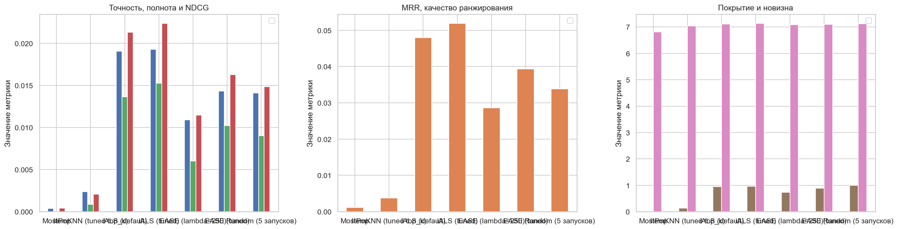
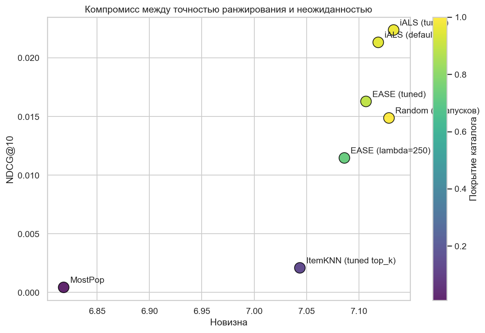
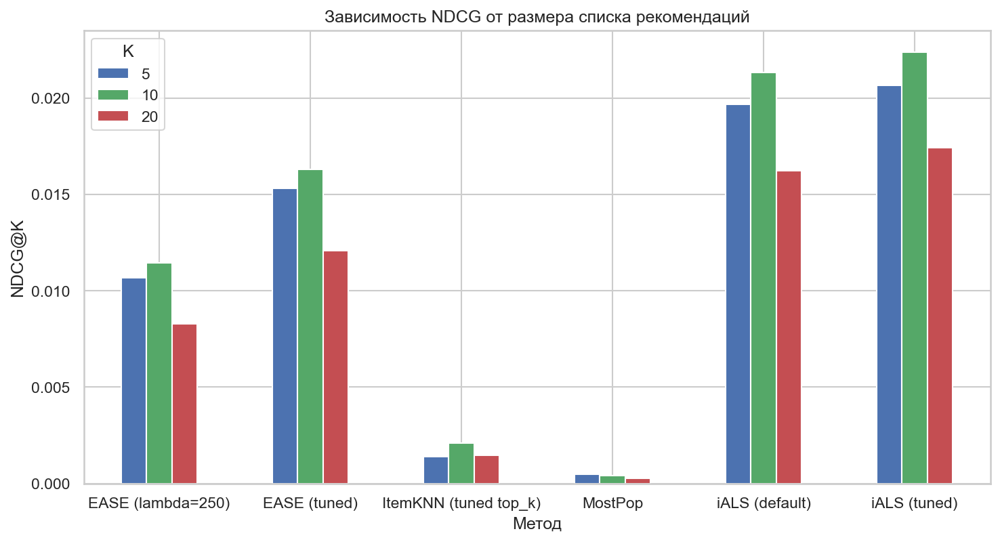
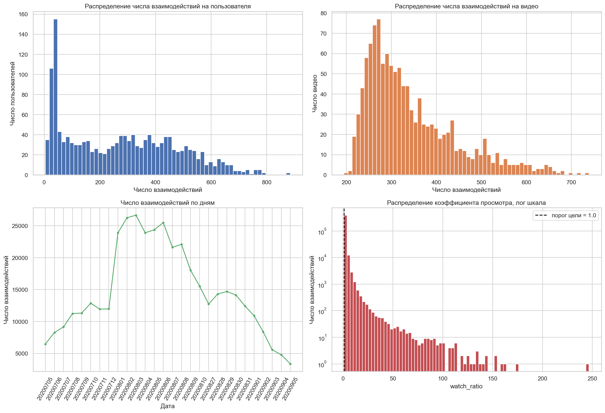
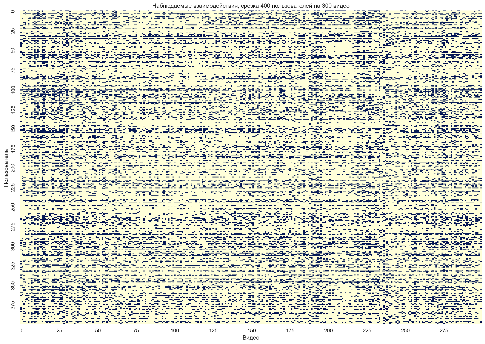

# Отчёт по лабораторной работе 2

Датасет: KuaiRec (Kuaishou, CIKM 2022), Zenodo. 412 422 взаимодействия, 1500 пользователей, 1200 видео.

## Данные
Поля: user_idx, item_id, watch_ratio, timestamp, date. watch_ratio, доля просмотра видео, больше 1 значит пересмотр.

## Целевая переменная
Рекомендуем видео, которое пользователь посмотрел не менее чем на 75 процентов (watch_ratio >= 0.75). Все показанные пары имеют метку 1. Негативы, это пары, которые не были показаны. Это главная причина низких метрик: цель слишком грубая.

## Качество данных
Пропусков нет, дублей пар нет, нулевых просмотров нет. Выбросы watch_ratio больше 3, это многократные пересмотры коротких видео, не ошибки, строки не удаляем.

## Разбиение на выборки
Обучающая: данные до 20200807, 255 385 взаимодействий (60 процентов).
Валидационная: с 20200807 по 20200828, 82 711 взаимодействий (20 процентов).
Тестовая: после 20200828, 74 322 взаимодействия (20 процентов).
Тестовая выборка не использовалась при обучении и подборе параметров.

## EDA (выводы своими словами)
Активность пользователей неравномерна: минимум 4 взаимодействия, медиана 269, максимум 885.
Популярность видео от 195 до 739 взаимодействий, медиана 314.
watch_ratio в среднем выше 1, есть тяжёлый хвост пересмотров.
Тепловая карта: заполнено 21 процента ячеек, нет чётких блоков, пользователи смотрят одни и те же популярные видео.
Пик активности в середине июля, потом спад. Сезонность оценить нельзя, период короткий.

## Методы
Random: 10 случайных видео из всех 1200 видео (базлайн, не исключает уже просмотренное, усреднено по 5 запускам).
MostPop: самые популярные видео для всех.
ItemKNN: косинусное сходство видео, 100–200 соседей.
EASE: линейная модель с нулевой диагональю.
iALS: матричная факторизация, ранг 32 или 64.

## Метрики
Precision@K, Recall@K, NDCG@K, MRR@K, HitRate@K (доля пользователей с хотя бы одним попаданием), Coverage@K, Novelty@K. K = 10.

## Результаты на тестовой выборке

| Метод | Precision | Recall | NDCG | MRR | HitRate | Coverage | Novelty |
| --- | --- | --- | --- | --- | --- | --- | --- |
| MostPop | 0.0004 | 0.0001 | 0.0004 | 0.0012 | 0.0023 | 0.0103 | 6.8182 |
| ItemKNN (tuned) | 0.0024 | 0.0009 | 0.0021 | 0.0037 | 0.0153 | 0.1301 | 7.0435 |
| EASE (lambda=250) | 0.0109 | 0.0060 | 0.0115 | 0.0287 | 0.0908 | 0.7275 | 7.0860 |
| Random (5 запусков) | 0.0141 | 0.0090 | 0.0149 | 0.0338 | 0.1206 | 1.0000 | 7.1286 |
| EASE (tuned) | 0.0144 | 0.0102 | 0.0163 | 0.0393 | 0.1183 | 0.8914 | 7.1066 |
| iALS (по умолчанию) | 0.0191 | 0.0137 | 0.0213 | 0.0480 | 0.1473 | 0.9508 | 7.1183 |
| iALS (настроенная) | 0.0193 | 0.0153 | 0.0224 | 0.0519 | 0.1603 | 0.9662 | 7.1330 |

## Интерпретация
- Случайная рекомендация (Random) не лучшая: по Precision и NDCG ниже iALS и EASE (настроенной).
- MostPop самый слабый, персонализация помогает.
- iALS и EASE (настроенные) лучше ItemKNN.
- HitRate низкий у всех моделей, меньше 20 процентов.
- Низкие метрики связаны с целевой переменной: бинарный порог просмотра слишком грубый, поэтому даже случайная рекомендация иногда попадает в цель.

## Подбор параметров
На валидации: EASE лучше при lambda=50, iALS лучше при factors=64, reg=0.01, confidence=20, ItemKNN лучше при top_k=200. Тюнинг улучшил качество, но не решил главную проблему.

## Выводы
- Добавлена валидационная выборка, тестовая не использовалась для подбора.
- Базлайны Random и MostPop добавлены. Random не превосходит основные модели.
- iALS и EASE лидируют по точности и ранжированию.
- Основная проблема, целевая переменная, нужно использовать долю просмотра или более строгий порог.
- HitRate добавлен для всех методов.

