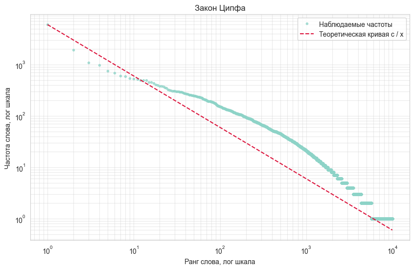
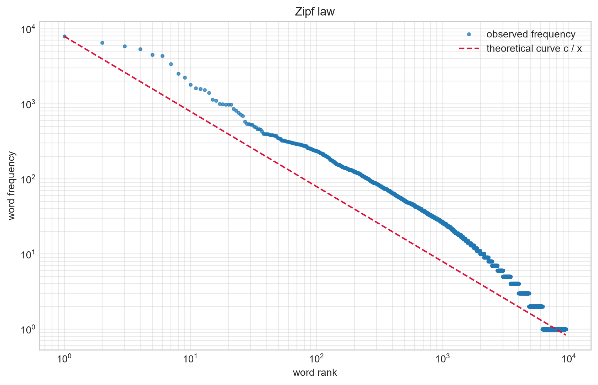
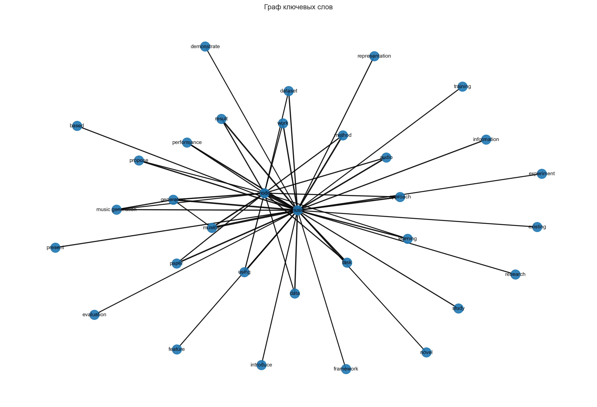
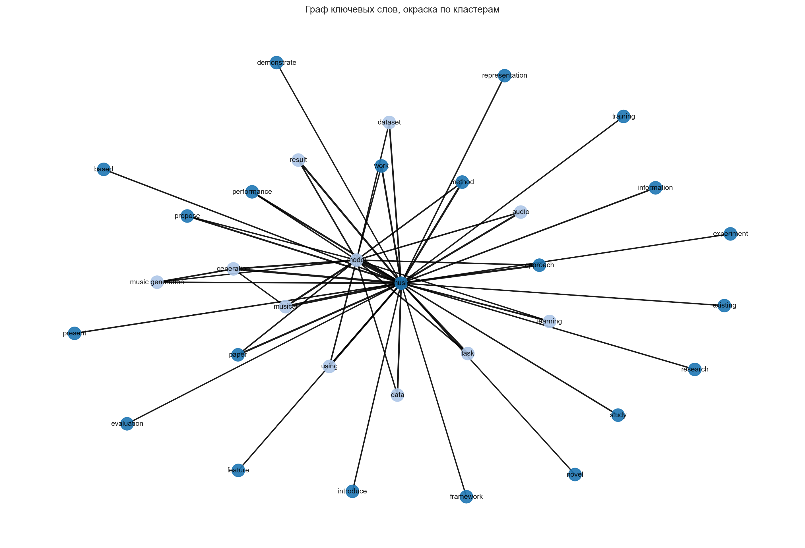

# Результаты лабораторной работы 1. Анализ публикаций arXiv по теме music

Источник данных: `arxiv_music_data.csv`, 1000 публикаций за 2021...2026 годы.

## EDA: распределение публикаций по годам и по длине текстов



## Закон Ципфа для слов корпуса



## Граф ключевых слов

Для прореживания графа оставляются связи с весом не менее 3, из них отбираются 50 самых значимых по наибольшему весу. Получено 33 узла и 50 рёбер.



## Кластеры графа ключевых слов



## Основные результаты ноутбука

```
Ключевых слов отобрано: 800 из 800

Граф ключевых слов: 33 узлов, 50 ребер
Вес ребер после фильтрации: от 201 до 640
Модулярность: 0.0916
Кластер 0 из 22 слов: approach, based, demonstrate, evaluation, existing,
  experiment, feature, framework, information, introduce, method, music, novel,
  paper, performance, present, propose, representation, research, study,
  training, work
Кластер 1 из 11 слов: audio, data, dataset, generation, learning, model,
  music generation, musical, result, task, using

Топ 5 по Degree:
  music: 1.0000
  model: 0.5312
  generation: 0.1250
  musical: 0.0938
  music generation: 0.0938
Топ 5 по Betweenness:
  music: 0.7258
  model: 0.2359
  music generation: 0.0323
  generation: 0.0020
  musical: 0.0000
Топ 5 по Eigenvector:
  music: 0.6058
  model: 0.4537
  musical: 0.2299
  generation: 0.2105
  method: 0.1536
Топ 5 по Closeness:
  music: 1.0000
  model: 0.6809
  generation: 0.5333
  musical: 0.5246
  music generation: 0.5246

Граф публикаций: 1000 узлов, 498444 ребер
```

## Поиск похожих публикаций

Результаты сортируются по числу общих слов, при равной релевантности учитывается вес связи с лучшей статьей в графе, затем год публикации, затем исходный порядок данных.

```
Исходная публикация: ProGress: Structured Music Generation via Graph Diffusion and Hierarchical Music Analysis (2025)
Совпадение: 4 общих слов, вес в графе 20: Generating music with sentiment using Transformer-GANs (2022)
Совпадение: 4 общих слов, вес в графе 19: Motifs, Phrases, and Beyond: The Modelling of Structure in Symbolic Music Generation (2024)
Совпадение: 4 общих слов, вес в графе 19: Graph-based Polyphonic Multitrack Music Generation (2023)

Исходная публикация: Dorabella Cipher as Musical Inspiration (2025)
Совпадение: 4 общих слов, вес в графе 0: Dorabella Cipher as Musical Inspiration (2025)
Совпадение: 2 общих слов, вес в графе 7: Exploring Musical Roots: Applying Audio Embeddings to Empower Influence Attribution for a Generative Music Model (2024)
Совпадение: 2 общих слов, вес в графе 6: SinTra: Learning an inspiration model from a single multi-track music segment (2022)
```